# Doctor Tracker – Frontend

## Description

Doctor Tracker is a secure admin portal for hospitals and clinics to manage doctors and their patients in one place. Authenticated admins can create and edit doctors, add or remove patients under a specific doctor, search, filter and paginate large lists, and watch live analytics (totals, patients per doctor, registrations over time, condition and specialization breakdowns) on a clean, responsive dashboard. This repository is the **Next.js client**; it talks to the standalone Express + MongoDB API (`doctor-tracker-backend`) over REST.

**Performance & UX details:** Recharts is lazy-loaded (`next/dynamic`, dashboard page JS ≈ 4 kB), `React.memo` + stable callbacks on tables/charts/cards, debounced search, `keepPreviousData` pagination, skeleton loaders, automatic fall-back to the last valid page after deleting the last item of a page, route `error.jsx` and `not-found.jsx`.

**Stack:** Next.js 14 (App Router) · **Bootstrap 5.3** (+ small custom theme in `globals.css`) · TanStack Query · React Hook Form · Recharts · axios.

**Features:** JWT login with silent token refresh · dashboard charts · doctors CRUD · patients CRUD · doctor → patients view · debounced search, filters (specialization, hospital, condition, gender, doctor, date range), sorting, server-side pagination · admin profile and password update · responsive layout with mobile drawer navigation.

## Setup Guide

**Requirements:** Node.js 18+, and the backend API running (see `doctor-tracker-backend/README.md`).

1. Start the backend first (default `http://localhost:5000`) and run its seed script so the demo admin exists.
2. Install dependencies
   ```bash
   cd doctor-tracker-frontend
   npm install
   ```
3. Create your environment file from the template (`.env.example` is included)
   ```bash
   cp .env.example .env.local
   ```
   | Variable | Purpose |
   |---|---|
   | `BACKEND_URL` | Express API URL used by the Next.js `/api/*` proxy |
   | `NEXT_PUBLIC_DEMO_LOGIN` | `true` shows the "Use demo credentials" button on the login page |
   | `NEXT_PUBLIC_DEMO_EMAIL` / `NEXT_PUBLIC_DEMO_PASSWORD` | credentials the demo button fills in (`admin@gmail.com` / `Admin@123456`) |

   > `NEXT_PUBLIC_*` values are bundled into the browser, so use throwaway demo credentials only and set `NEXT_PUBLIC_DEMO_LOGIN=false` for real production use.
4. Run
   ```bash
   npm run dev            # http://localhost:3000
   # production
   npm run build && npm start
   ```
5. Open http://localhost:3000, click **Use demo credentials**, then **Sign in**.

## System Architecture

```
┌────────────┐   /api/*    ┌──────────────────┐  rewrite   ┌───────────────┐   Mongoose   ┌─────────┐
│  Browser   │────────────▶│ Next.js (client) │───────────▶│ Express API   │─────────────▶│ MongoDB │
│ React UI   │◀────────────│ UI + proxy       │◀───────────│ JWT, REST     │◀─────────────│         │
└────────────┘ httpOnly    └──────────────────┘            └───────────────┘              └─────────┘
               cookies
```

1. The browser only talks to the Next.js origin. `next.config.mjs` rewrites `/api/*` to the Express server, so authentication cookies are first-party.
2. Route protection has three layers: (a) `src/middleware.js` redirects anonymous visitors to `/login` on the server before any protected page is rendered, (b) `AuthContext` loads the session via `GET /auth/me` and the `app/(app)/layout.jsx` guard handles expired or invalid sessions, (c) the Express API verifies the JWT on every request, which is the real security boundary.
3. Every request goes through one axios instance (`lib/api.js`). On `401` it calls `/auth/refresh` once (shared by concurrent requests) and retries; if refresh fails the user is signed out.
4. Server state (lists, stats, filters) is fetched and cached with TanStack Query; filters and pagination are query parameters, so searching, filtering and paging run in MongoDB.
5. After any create/update/delete, active queries are invalidated so tables, counters and the dashboard stay consistent.

```
src/
├── app/            # routes: login, (app)/dashboard, doctors, doctors/[id], patients, profile
├── components/     # ui (Bootstrap-based reusable components), common, layout, dashboard, doctors, patients
├── context/        # AuthContext
├── hooks/          # useDebounce, useListState, useInvalidate
├── services/       # all REST calls
└── lib/            # axios instance, helpers
```

## Technical Decisions

### 1. Next.js rewrite proxy + httpOnly cookie sessions (instead of tokens in localStorage)
The API is a separate Express server, which normally means CORS configuration and cross-site cookies (`SameSite=None; Secure`). Instead, the browser calls `/api/*` on the Next.js origin and Next rewrites those calls to Express. Access and refresh JWTs live in **httpOnly** cookies, so an XSS bug cannot read them (they would be exposed in `localStorage`). An axios interceptor transparently refreshes the 15-minute access token using the 7-day refresh token and retries the failed request, so users are not kicked out mid-work. Trade-off: one extra hop through Next.js. The middleware only checks a non-sensitive `session` marker cookie (the 15-minute access token would expire too soon to gate pages), so it is a UX/performance gate, not a security boundary; real authorization is enforced by the API on every request.

### 2. TanStack Query for server state (instead of Redux / Context)
Almost all state in this app is *server* state: lists, counts and analytics. Putting that in Redux would mean hand-writing loading flags, caching, de-duplication and invalidation. TanStack Query gives these out of the box: per-query caching, `keepPreviousData` for flicker-free pagination, request de-duplication and one-line invalidation after mutations. The only global client state is the session (a small `AuthContext`), and list filters live in a tiny `useListState` hook. Search input is debounced (400 ms) and any filter change resets to page 1, so each user action produces exactly one request, and the browser never loads whole collections.

## Visual Evidence

Screenshots were generated with sample data (14 doctors, 220 patients).

### Desktop (1440 px)

| Login (demo credentials + password eye) | Dashboard |
|---|---|
| 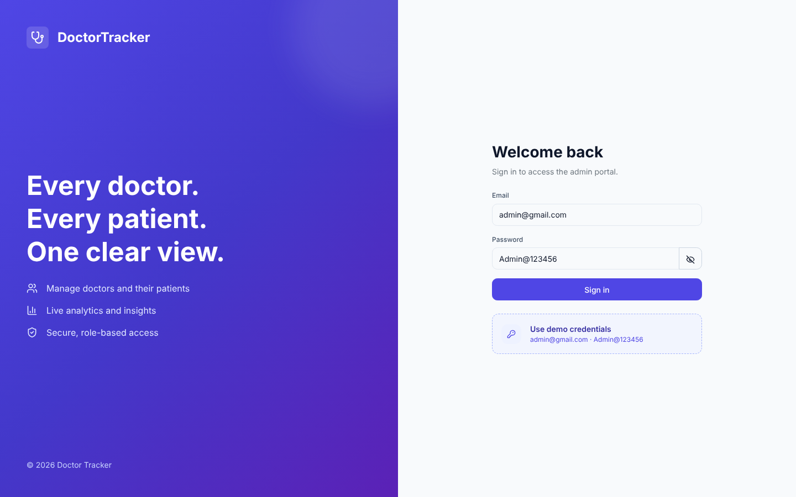 | 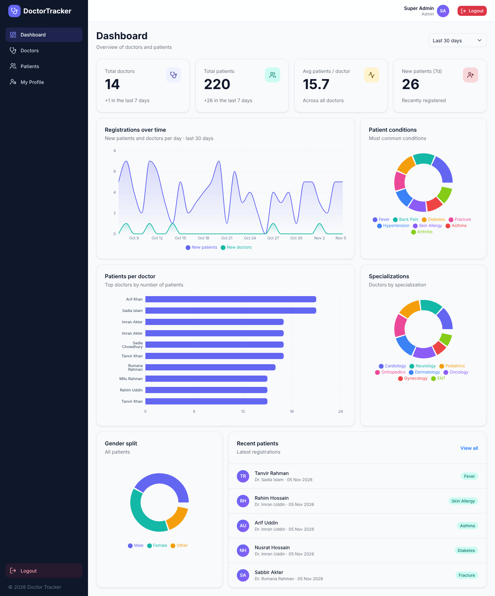 |

| Doctors | Doctor detail + patients |
|---|---|
| 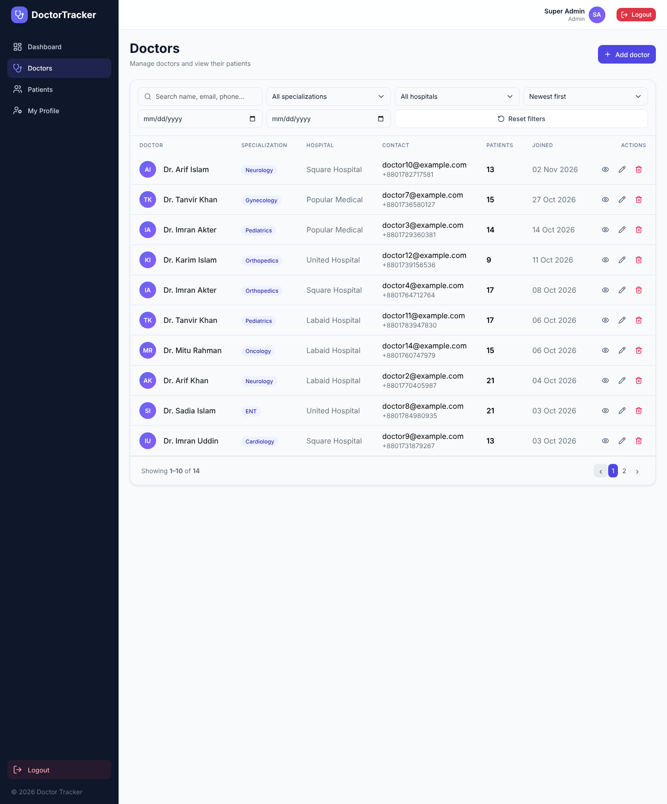 | 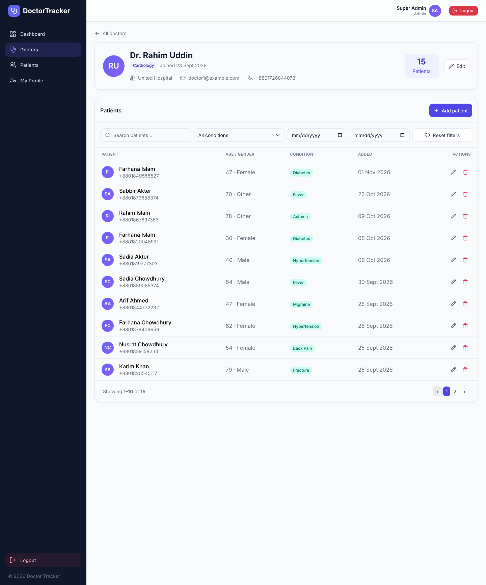 |

| Patients | My profile |
|---|---|
| 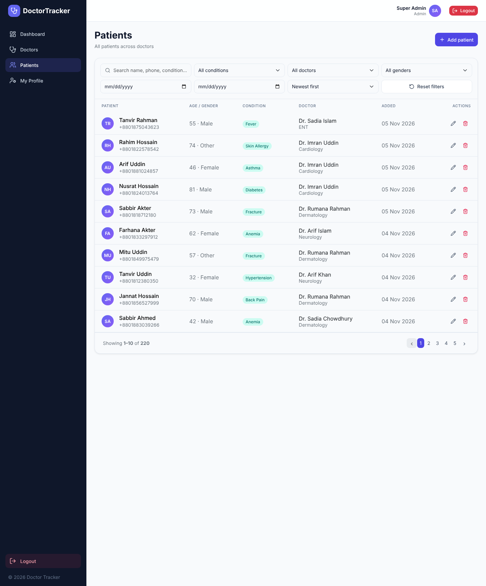 | 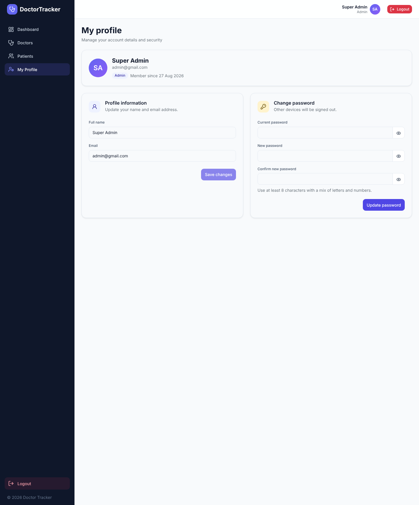 |

### Mobile (390 px)

| Login | Dashboard | Doctors | Doctor detail |
|---|---|---|---|
| 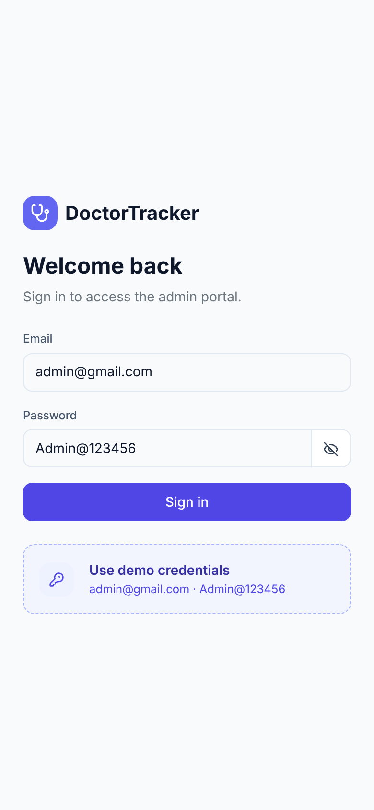 | 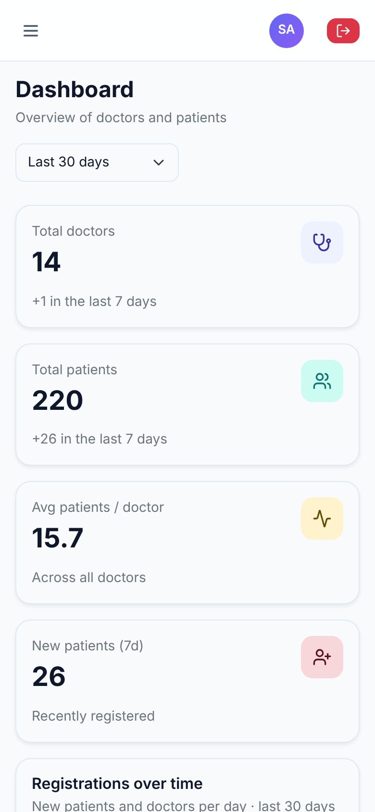 | 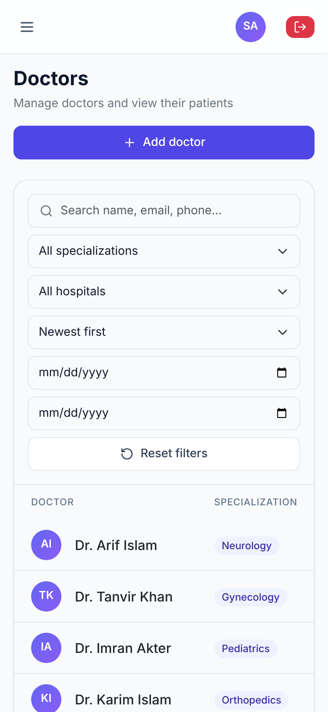 | 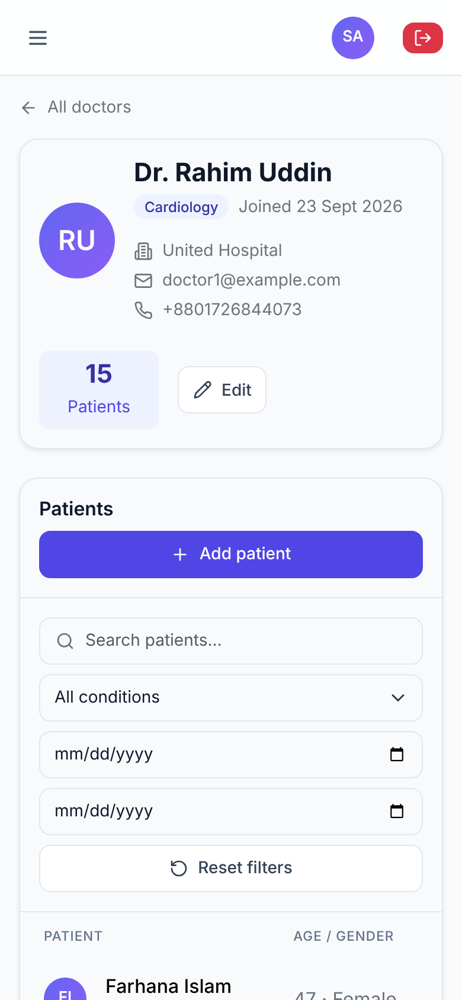 |

| Patients | Profile | Navigation drawer |
|---|---|---|
| 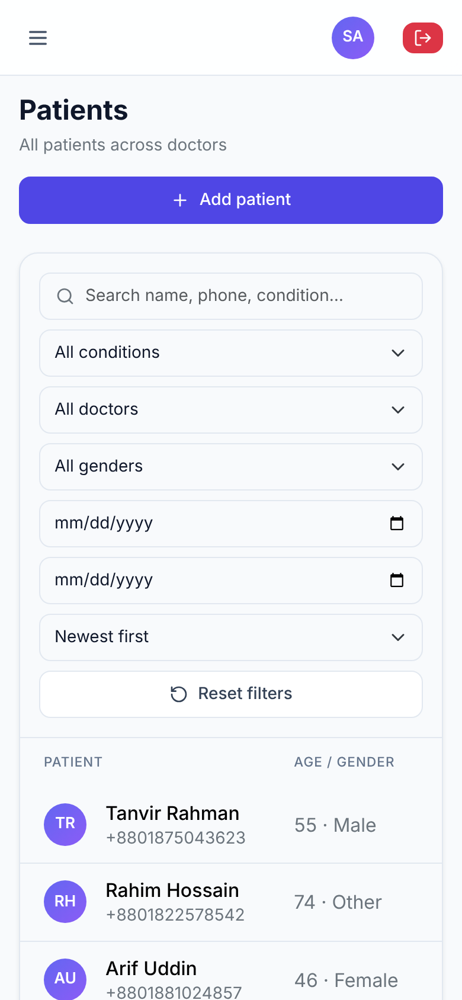 | 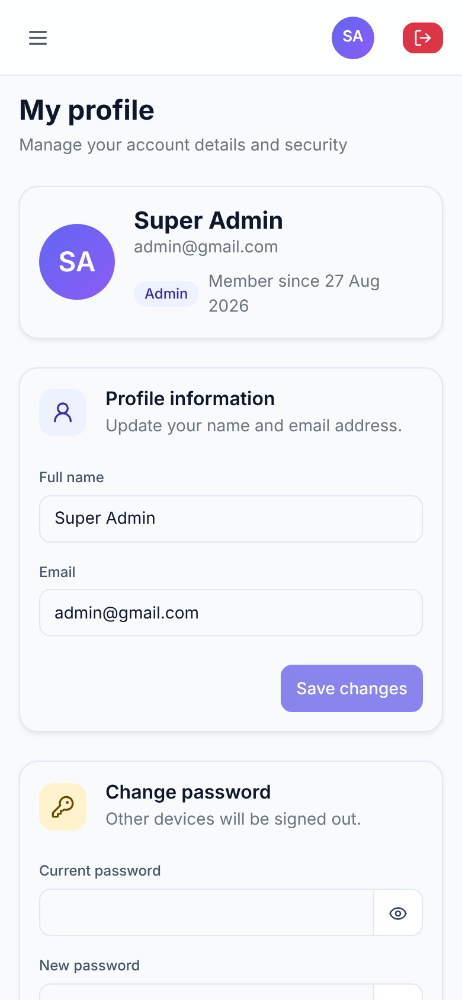 | 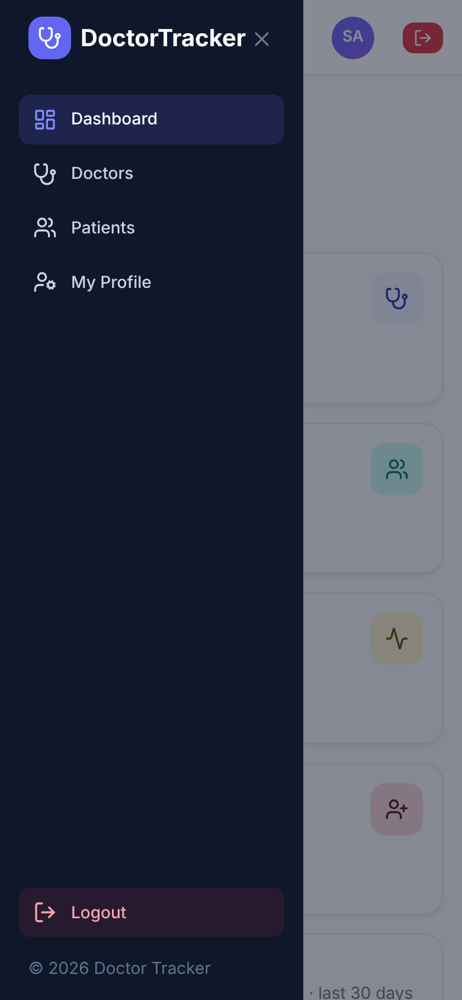 |

## Deployment

1. Deploy the backend (Render / Railway / any Node host) with a MongoDB Atlas `MONGODB_URI`, set `NODE_ENV=production`, the two JWT secrets and `CLIENT_URL` (the frontend URL).
2. Deploy this app (Vercel) and set `BACKEND_URL` to the deployed API URL. Because requests go through the Next.js `/api` proxy, no cross-site cookie settings are needed.
3. Set `NEXT_PUBLIC_DEMO_LOGIN=true` only if you want the demo-credentials button on the public login page.
